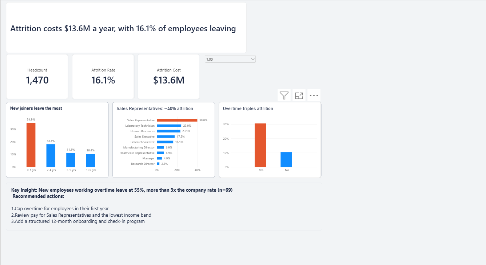

# HR Attrition Analysis | Power BI Dashboard

## Business question
Who is leaving, why, and what is it costing us?

## Key findings
- **Overall attrition is 16.1%** (237 of 1,470 employees), costing about **$13.6M a year** (assuming replacement cost = 1x annual salary, adjustable in the dashboard)
- **Overtime is the biggest driver:** employees working overtime leave at 30.5% vs 10.4% for those who don't
- **The first year is the danger zone:** employees with 0-1 years of tenure leave at 34.9%
- **Risks compound:** new employees working overtime leave at **55.1%** (n=69), more than 3x the company average
- **Sales Representatives** have the highest role-level attrition at 39.8%

## Recommendations
1. Cap overtime for employees in their first year
2. Review pay for Sales Representatives and the lowest income band
3. Add a structured 12-month onboarding and check-in program

## What I built
- **Power Query:** cleaned data, removed constant columns, created Attrition Flag, Age Group, Tenure Band and Income Band, and decoded survey scores into labels
- **Data model:** star schema with a fact table and dimension tables, with sort-order columns for bands
- **DAX:** Attrition Rate, Headcount, Attrition Cost, company benchmark comparisons and a dynamic headline
- **Storytelling:** action titles, a restrained color palette, and highlight colors on the problem groups only

## Assumptions and limitations
- Dataset is fictional, created by IBM data scientists for demonstration, so findings are illustrative, not real company results
- Replacement cost is an assumption, not in the data
- Associations shown are not proof of causation

## Data source
[IBM HR Analytics Employee Attrition & Performance (Kaggle)](https://www.kaggle.com/datasets/pavansubhasht/ibm-hr-analytics-attrition-dataset)

## Tools
Power BI Desktop, Power Query, DAX
